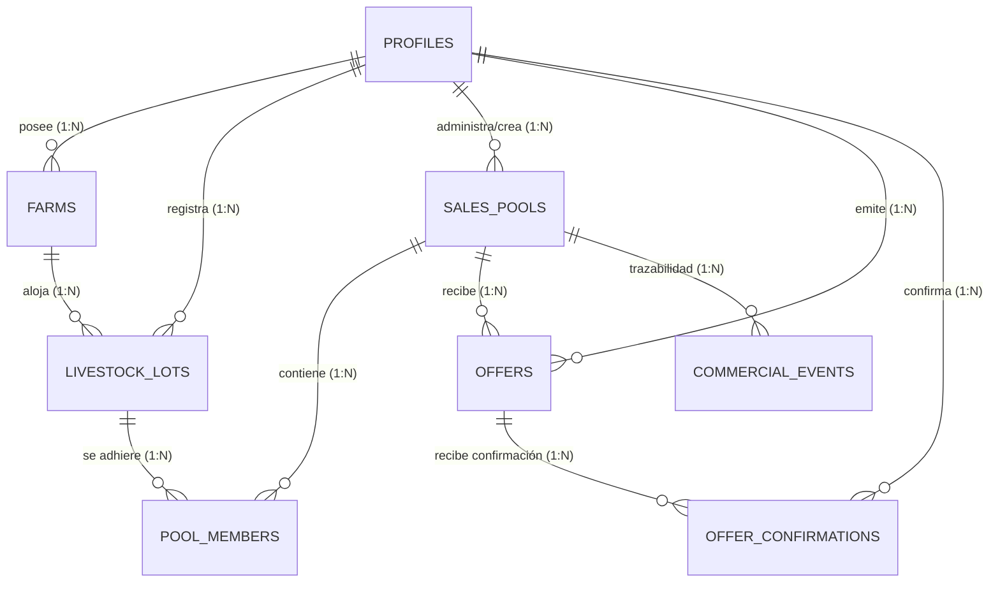

# YVYPASS — Especificación de Base de Datos PostgreSQL

> **Base de Datos:** PostgreSQL 15+ / Supabase  
> **Ubicación de Migraciones:** `supabase/migrations/`  
> **Responsable:** Persona 1 (Backend, Database & Security)

Este documento detalla el modelo de datos relacional, restricciones de integridad, enumeraciones, índices y procedimientos almacenados (RPCs) transaccionales que sustentan la plataforma **YvyPass**.

---

## 1. Diagrama Entidad-Relación Conceptual

---

## 2. Tipos y Enumeraciones (Enums)

| Enum | Valores Permitidos | Descripción |
| :--- | :--- | :--- |
| `user_role` | `productor`, `comprador`, `operador` | Rol asignado al perfil autenticado |
| `livestock_category` | `ternero`, `ternera`, `novillo`, `vaquillona`, `vaca`, `toro` | Categoría zootécnica admitida |
| `verification_status`| `declarado`, `pendiente`, `revisado` | Estado de verificación (no oficial sin comprobante) |
| `lot_status` | `disponible`, `reservado`, `vendido` | Ciclo de vida del lote de hacienda |
| `pool_status` | `abierto`, `objetivo_alcanzado`, `en_negociacion`, `cerrado`, `cancelado` | Estado del pool de venta conjunta |
| `offer_status` | `pendiente`, `aceptada`, `rechazada` | Estado de la oferta indicativa de compra |

---

## 3. Tablas y Columnas

### 3.1 `profiles`
Extensión directa de `auth.users` vinculada mediante clave foránea con borrado en cascada.

| Columna | Tipo | Restricción | Descripción |
| :--- | :--- | :--- | :--- |
| `id` | `UUID` | `PK`, `REFERENCES auth.users(id)` | Identificador idéntico al usuario en Auth |
| `full_name` | `TEXT` | `NOT NULL` | Nombre completo o razón social |
| `role` | `user_role` | `NOT NULL DEFAULT 'productor'` | Rol del usuario (protegido contra manipulación) |
| `phone` | `TEXT` | `NULL` | Teléfono de contacto privado |
| `zone` | `TEXT` | `NULL` | Departamento / Localidad de Corrientes |
| `created_at` | `TIMESTAMPTZ`| `DEFAULT now()` | Fecha de alta |

### 3.2 `farms`
Establecimientos o campos ganaderos de los productores.

| Columna | Tipo | Restricción | Descripción |
| :--- | :--- | :--- | :--- |
| `id` | `UUID` | `PK DEFAULT gen_random_uuid()` | Identificador único del establecimiento |
| `owner_id` | `UUID` | `REFERENCES profiles(id)` | Productor dueño del campo |
| `name` | `TEXT` | `NOT NULL CHECK (length >= 2)` | Nombre del campo o estancia |
| `zone` | `TEXT` | `NOT NULL` | Localidad / Departamento (e.g. Curuzú Cuatiá) |
| `province` | `TEXT` | `NOT NULL DEFAULT 'Corrientes'` | Provincia |
| `approximate_lat` | `NUMERIC(9,6)` | `NULL` | Coordenada aproximada (zona general, no exacta) |
| `approximate_lng` | `NUMERIC(9,6)` | `NULL` | Coordenada aproximada |
| `created_at` | `TIMESTAMPTZ`| `DEFAULT now()` | Fecha de registro |

### 3.3 `livestock_lots`
Lotes ganaderos registrados por los productores.

| Columna | Tipo | Restricción | Descripción |
| :--- | :--- | :--- | :--- |
| `id` | `UUID` | `PK DEFAULT gen_random_uuid()` | Identificador del lote |
| `producer_id` | `UUID` | `REFERENCES profiles(id)` | Productor dueño de los animales |
| `farm_id` | `UUID` | `REFERENCES farms(id)` | Establecimiento donde se ubica el lote |
| `title` | `TEXT` | `NOT NULL CHECK (length >= 3)` | Título descriptivo comercial |
| `category` | `livestock_category` | `NOT NULL` | Categoría zootécnica |
| `breed` | `TEXT` | `NOT NULL` | Raza predominante (Braford, Brangus, etc.) |
| `head_count` | `INTEGER` | `NOT NULL CHECK (head_count > 0)` | Cantidad de cabezas |
| `average_weight_kg`| `NUMERIC(8,2)` | `NOT NULL CHECK (> 0)` | Peso promedio estimado en kg |
| `electronic_tag_reference`| `TEXT` | `NULL` | Referencia de caravana declarada |
| `verification_status`| `verification_status`| `DEFAULT 'declarado'` | Estado de declaración de caravana |
| `status` | `lot_status` | `DEFAULT 'disponible'` | `disponible`, `reservado` o `vendido` |
| `created_at` | `TIMESTAMPTZ`| `DEFAULT now()` | Fecha de alta |

### 3.4 `sales_pools`
Pools de venta conjunta que agrupan lotes de múltiples productores.

| Columna | Tipo | Restricción | Descripción |
| :--- | :--- | :--- | :--- |
| `id` | `UUID` | `PK DEFAULT gen_random_uuid()` | Identificador del pool |
| `title` | `TEXT` | `NOT NULL CHECK (length >= 3)` | Título comercial (e.g. Pool Novillos 400) |
| `zone` | `TEXT` | `NOT NULL` | Zona homogénea requerida para flete conjunto |
| `category` | `livestock_category` | `NOT NULL` | Categoría requerida para el lote conjunto |
| `target_heads` | `INTEGER` | `NOT NULL CHECK (> 0)` | Objetivo de cabezas para cerrar el lote comercial |
| `status` | `pool_status`| `DEFAULT 'abierto'` | Estado del ciclo de venta |
| `created_by` | `UUID` | `REFERENCES profiles(id)` | Usuario que abrió la convocatoria |
| `created_at` | `TIMESTAMPTZ`| `DEFAULT now()` | Fecha de creación |

### 3.5 `pool_members`
Vínculo N:M entre un lote y un pool.

| Columna | Tipo | Restricción | Descripción |
| :--- | :--- | :--- | :--- |
| `id` | `UUID` | `PK DEFAULT gen_random_uuid()` | Identificador de adhesión |
| `pool_id` | `UUID` | `REFERENCES sales_pools(id)` | Pool al que se adhiere |
| `lot_id` | `UUID` | `REFERENCES livestock_lots(id)` | Lote reservado |
| `joined_at` | `TIMESTAMPTZ`| `DEFAULT now()` | Timestamp de adhesión |
| — | — | `UNIQUE (pool_id, lot_id)` | Impide doble adhesión del mismo lote al pool |

### 3.6 `offers`
Ofertas comerciales presentadas por compradores calificados.

| Columna | Tipo | Restricción | Descripción |
| :--- | :--- | :--- | :--- |
| `id` | `UUID` | `PK DEFAULT gen_random_uuid()` | Identificador de la oferta |
| `pool_id` | `UUID` | `REFERENCES sales_pools(id)` | Pool destinatario |
| `buyer_id` | `UUID` | `REFERENCES profiles(id)` | Comprador emisor |
| `price_per_kg` | `NUMERIC(10,2)`| `NOT NULL CHECK (> 0)` | Precio indicativo por kg en pesos |
| `status` | `offer_status` | `DEFAULT 'pendiente'` | `pendiente`, `aceptada`, `rechazada` |
| `created_at` | `TIMESTAMPTZ`| `DEFAULT now()` | Fecha de emisión |
| — | — | `UNIQUE INDEX (pool_id) WHERE status = 'pendiente'` | Máximo 1 oferta activa simultánea por pool en MVP |

### 3.7 `offer_confirmations`
Aceptación o rechazo individual por productor participante.

| Columna | Tipo | Restricción | Descripción |
| :--- | :--- | :--- | :--- |
| `id` | `UUID` | `PK DEFAULT gen_random_uuid()` | Identificador de confirmación |
| `offer_id` | `UUID` | `REFERENCES offers(id)` | Oferta a la que responde |
| `producer_id` | `UUID` | `REFERENCES profiles(id)` | Productor votante |
| `accepted` | `BOOLEAN` | `NOT NULL` | `true` = acepta, `false` = rechaza |
| `created_at` | `TIMESTAMPTZ`| `DEFAULT now()` | Timestamp de voto |
| — | — | `UNIQUE (offer_id, producer_id)` | Una sola decisión por productor |

### 3.8 `commercial_events`
Libro de eventos inmutable para trazabilidad y auditoría.

| Columna | Tipo | Restricción | Descripción |
| :--- | :--- | :--- | :--- |
| `id` | `UUID` | `PK DEFAULT gen_random_uuid()` | Identificador del evento |
| `pool_id` | `UUID` | `REFERENCES sales_pools(id)` | Pool afectado |
| `actor_id` | `UUID` | `REFERENCES profiles(id)` | Usuario que desencadenó el evento |
| `event_type` | `TEXT` | `NOT NULL` | Tipo de hito comercial |
| `details` | `JSONB` | `DEFAULT '{}'::jsonb` | Metadatos y contexto del evento |
| `created_at` | `TIMESTAMPTZ`| `DEFAULT now()` | Fecha y hora exacta |

---

## 4. Procedimientos Almacenados Transaccionales (RPCs)

1. **`rpc_join_pool(p_pool_id UUID, p_lot_id UUID)`**:
   - Bloquea filas del pool y del lote con `FOR UPDATE`.
   - Verifica compatibilidad de categoría y zona geográfica.
   - Calcula el total acumulado de cabezas.
   - Si no supera el objetivo, reserva el lote (`status = 'reservado'`) y registra la adhesión.
   - Si alcanza el objetivo exacto, actualiza el pool a `objetivo_alcanzado`.
2. **`rpc_leave_pool(p_pool_id UUID, p_lot_id UUID)`**:
   - Permite retirar un lote propio mientras el pool no esté en negociación con ofertas activas.
   - Libera el lote a `disponible` y recalcula cabezas.
3. **`rpc_create_offer(p_pool_id UUID, p_price_per_kg NUMERIC)`**:
   - Exclusivo para rol `comprador`.
   - Verifica que el pool tenga `objetivo_alcanzado`.
   - Inserta oferta y pasa el pool a `en_negociacion`.
4. **`rpc_confirm_offer(p_offer_id UUID, p_accepted BOOLEAN)`**:
   - Verifica que el productor pertenezca al pool.
   - Registra voto único. Si rechaza, la oferta pasa a `rechazada` y el pool a `objetivo_alcanzado`.
5. **`rpc_close_pool(p_pool_id UUID)`**:
   - Exclusivo para rol `operador`.
   - Verifica que el 100% de los productores hayan aceptado.
   - Cierra el pool, aprueba la oferta y marca los lotes como vendidos (DEMO).
